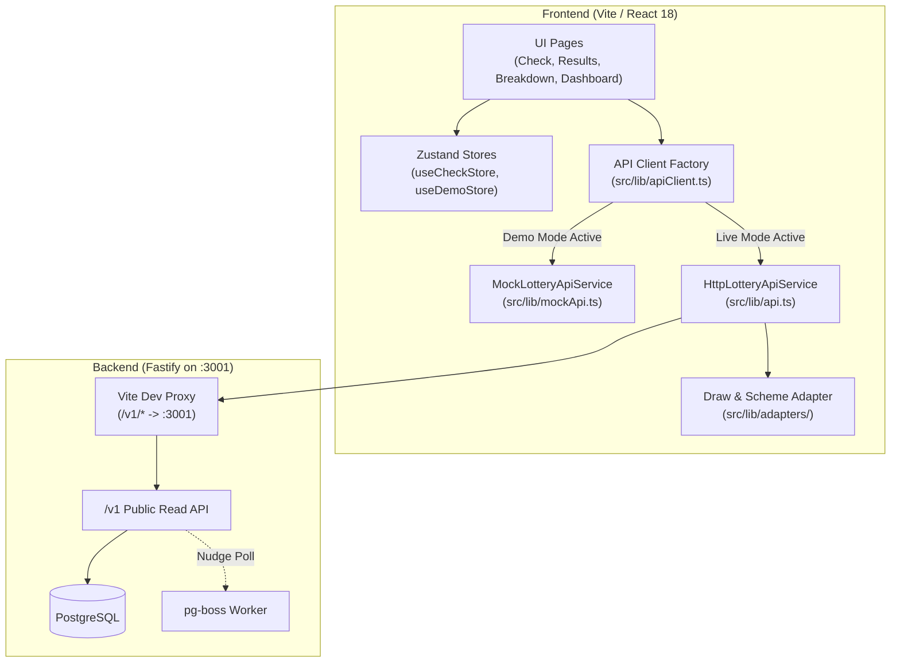

# gacha Frontend — Backend Integration Plan

This document outlines the architectural plan, contract specifications, and phased implementation steps to integrate the `frontend/` (React + Vite + TypeScript + Tailwind) with the completed `backend/` (Fastify + PostgreSQL + Drizzle + pg-boss).

---

## 1. Executive Summary & Goals

### 1.1 Goal
Connect the frontend user interface to live backend APIs (`/v1`) running on port `3001`, replacing hardcoded static mock data while:
1. **Preserving 100% of existing animations, gestures, and UI layouts.**
2. **Maintaining zero latency feel (<16ms framer-motion animations)** during ticket checking via hybrid client/server execution.
3. **Preserving the Demo Mode / Mock Toggle** so users and developers can switch between Live Backend and Local Mock Scenarios (essential for offline demos, presentations, and forced win testing).
4. **Enriching the UI with live features** supported by the backend: Winner Agencies (sellers and districts), live draw status alerts ("Results Pending" / "Drawn Today"), and background poller nudge requests.

---

## 2. Architecture & Service Topology



---

## 3. API Contract & Data Model Mapping

### 3.1 Interface Alignment (`LotteryApi`)

The frontend currently programs against the `LotteryApi` TypeScript interface defined in `frontend/src/types/index.ts`. Below is the exact mapping to backend REST endpoints:

| `LotteryApi` Method | Current Mock Behavior | Target Backend API Endpoint | Cache Policy |
| :--- | :--- | :--- | :--- |
| `getDraws()` | Returns static `SEED_DRAWS` | `GET /v1/draws?limit=50` | `public, max-age=60, s-maxage=300` |
| `getLatestDraw(schemeCode?)` | Filters `SEED_DRAWS` for latest published | `GET /v1/draws/latest?scheme=:code` | `public, max-age=30, s-maxage=60` |
| `getDrawById(id)` | Finds draw by `id` in `SEED_DRAWS` | `GET /v1/draws/:id` | `public, max-age=300, s-maxage=3600` |
| `checkTicket(ticket, draw)` | Evaluates client-side pure function | `POST /v1/draws/:id/check` (plus client-side fast path) | Non-cached POST |
| `nudge(drawCode)` | None (unsupported) | `POST /v1/draws/:id/nudge` | Rate limited (1 / IP / min) |
| `getHistory()` | Reads from browser `localStorage` | Browser `localStorage` (Phase 1) | Local |
| `saveTicket(ticket)` | Upserts to browser `localStorage` | Browser `localStorage` (Phase 1) | Local |
| `getStats()` | Derived pure reduction over `getHistory()` | Client-side pure calculation over local tickets | Local |

---

### 3.2 Scheme Code Normalization

The frontend mock data originally used 1-letter codes, while the official Kerala State Lottery departmental designations use standard 1 to 2-letter codes. The table below ensures 100% compatibility:

| Departmental Scheme Code | Scheme Name | Frontend Alias | Draw Prefix | Price | Weekday | First Prize |
| :--- | :--- | :--- | :--- | :--- | :--- | :--- |
| `W` | Win-Win | `W` | `W` | ₹40 | Monday | ₹75,00,000 |
| `SS` | Sthree Sakthi | `S` / `SS` | `SS` | ₹40 | Tuesday | ₹75,00,000 |
| `AK` | Akshaya | `A` / `AK` | `AK` | ₹40 | Wednesday | ₹70,00,000 |
| `KN` | Karunya Plus | `K` / `KN` | `KN` | ₹40 | Thursday | ₹80,00,000 |
| `NR` | Nirmal | `NR` | `NR` | ₹40 | Friday | ₹70,00,000 |
| `KR` | Karunya | `KR` | `KR` | ₹40 | Saturday | ₹80,00,000 |
| `SM` / `BT` | Samrudhi / Bhagyathara | `SM` / `BT` | `SM` / `BT` | ₹50 | Sunday | ₹1,00,00,000 |

*Adapter rule: The adapter resolves both single-letter aliases (`S`, `A`, `K`) and canonical codes (`SS`, `AK`, `KN`) transparently.*

---

### 3.3 Draw Data Adapter (`drawAdapter.ts`)

The backend stores prize tiers relationally in a normalized structure (`tiers: Array<{ tier, amount, matchType, entries }>`), whereas the frontend's existing components consume a structured `prizes` object (`firstPrize`, `consolationPrize`, `secondPrize`, `thirdPrize`, `last4Prizes`).

The adapter bridges these formats without requiring any breaking changes to existing UI components:

```typescript
// frontend/src/lib/adapters/drawAdapter.ts
import { Draw } from "@/types";

export interface BackendPrizeTier {
  tier: string;
  amount: number;
  matchType: "full" | "consolation" | "last4";
  entries: string[];
}

export interface BackendWinnerAgency {
  tier: string;
  ticket: string;
  agencyName: string | null;
  agencyCode: string | null;
  place: string | null;
  source: string;
}

export interface BackendFullDraw {
  id: string;
  schemeCode: string;
  schemeName: string;
  drawCode: string;
  drawDate: string;
  status: "expected" | "observed" | "published" | "needs_review";
  publishedAt: string | null;
  tiers: BackendPrizeTier[];
  agencies: BackendWinnerAgency[];
}

export function toFrontendDraw(backend: BackendFullDraw): Draw {
  const isPublished = backend.status === "published";

  if (!isPublished || !backend.tiers || backend.tiers.length === 0) {
    return {
      id: backend.drawCode,
      schemeCode: backend.schemeCode,
      drawNumber: parseInt(backend.drawCode.replace(/\D/g, ""), 10) || 0,
      drawDate: backend.drawDate,
      isPublished: false,
    };
  }

  // 1st Prize
  const tier1 = backend.tiers.find((t) => t.tier === "1");
  const firstPrizeEntry = tier1?.entries[0] || "";
  const firstSeries = firstPrizeEntry.slice(0, 2);
  const firstNumber = firstPrizeEntry.slice(2);

  // Consolation Prize
  const consol = backend.tiers.find((t) => t.tier === "consolation");

  // 2nd Prize
  const tier2 = backend.tiers.find((t) => t.tier === "2");
  const secondPrize = tier2
    ? {
        number: tier2.entries[0] || "",
        amount: tier2.amount,
      }
    : undefined;

  // 3rd Prize
  const tier3 = backend.tiers.find((t) => t.tier === "3");
  const thirdPrize = tier3
    ? {
        numbers: tier3.entries,
        amount: tier3.amount,
      }
    : undefined;

  // Lower Tiers (4th through 9th)
  const last4Tiers = backend.tiers.filter(
    (t) => t.matchType === "last4" || (!["1", "2", "3", "consolation"].includes(t.tier))
  );

  const last4Prizes = last4Tiers.map((t) => ({
    tier: isNaN(Number(t.tier)) ? t.tier : `${t.tier}th Prize`,
    numbers: t.entries,
    amount: t.amount,
  }));

  return {
    id: backend.drawCode,
    schemeCode: backend.schemeCode,
    drawNumber: parseInt(backend.drawCode.replace(/\D/g, ""), 10) || 0,
    drawDate: backend.drawDate,
    isPublished: true,
    prizes: {
      firstPrize: {
        series: firstSeries,
        number: firstNumber,
        amount: tier1 ? tier1.amount : 0,
      },
      consolationPrize: {
        amount: consol ? consol.amount : 8000,
      },
      secondPrize,
      thirdPrize,
      last4Prizes,
    },
    // Enriched metadata for UI enhancements
    agencies: backend.agencies,
  } as Draw;
}
```

---

## 4. Phased Implementation Roadmap

### Phase 1: Network & Development Proxy Setup
1. **Configure Vite Proxy** (`frontend/vite.config.ts`):
   - Add a reverse proxy in `vite.config.ts` forwarding `/v1` to `http://localhost:3001/v1`.
   - Eliminates CORS preflight issues during local development.
2. **Environment Variables** (`frontend/.env` & `.env.example`):
   - Define `VITE_API_URL=/v1` for default proxy routing.
   - Define `VITE_ENABLE_MOCK=false` (can be toggled in settings or dev).

### Phase 2: HTTP Client & Data Adapters
1. **Create Adapters**:
   - `frontend/src/lib/adapters/drawAdapter.ts`: Implements `toFrontendDraw` (mapping relational tiers to hierarchical `prizes`).
   - `frontend/src/lib/adapters/schemeAdapter.ts`: Validates backend scheme listings against frontend theme palettes.
2. **Implement `HttpLotteryApiService`** (`frontend/src/lib/api.ts`):
   - Implements the `LotteryApi` interface using native `fetch`.
   - Handles `304 Not Modified` via ETags and automatic JSON decoding.
   - Handles network timeouts and offline fallbacks.

### Phase 3: API Client Factory & Demo Mode Switcher
1. **Create API Dispatcher** (`frontend/src/lib/apiClient.ts`):
   ```typescript
   import { LotteryApi } from "@/types";
   import { mockLotteryApi } from "./mockApi";
   import { httpLotteryApi } from "./api";
   import { useDemoStore } from "@/store/useDemoStore";

   export function getLotteryApi(): LotteryApi {
     const isDemo = useDemoStore.getState().isDemoMode;
     return isDemo ? mockLotteryApi : httpLotteryApi;
   }
   ```
2. **Add Source Switcher to Settings / Demo Menu**:
   - Provide a toggle in `Settings.tsx` and `DemoMenuModal.tsx`:
     - `● Live Backend (http://localhost:3001)`
     - `○ Demo Mode (Local Static Seeds)`

### Phase 4: Hybrid Ticket Checking Execution
1. **Dual Evaluation Strategy** (`frontend/src/pages/Check.tsx`):
   - **Instant Client Evaluation**: Executes local `checkTicket(parsed, activeDraw)` instantly (<1ms) to drive the 60fps Framer Motion slot machine & reveal sequence without network delay.
   - **Parallel Backend Verification**: Asynchronously posts to `POST /v1/draws/:id/check`. If any disparity is detected, the server's authoritative verdict takes precedence.
   - **Unpublished Draw Nudge**: If a user checks a ticket for today's expected draw where results are pending, display a "Nudge Worker" button calling `POST /v1/draws/:id/nudge` to trigger an immediate live poll.

### Phase 5: Winner Agencies UI Enhancement
1. **Update `ResultBreakdown.tsx`**:
   - The backend provides verified lottery agents and districts (`agencies: [{ ticket, agencyName, place, agencyCode }]`).
   - Render a dedicated **"Winning Ticket Agents & Districts"** section on the draw breakdown page, showing which agency sold the 1st prize and 2nd prize tickets.

---

## 5. Verification & Testing Plan

### 5.1 Unit Tests
- Add `frontend/src/lib/adapters/__tests__/drawAdapter.test.ts` to test:
  - Conversion of 1st prize, consolation prize, 2nd, 3rd, and last4 tiers.
  - Conversion of unpublished draws (`status: "expected"` or `"needs_review"`).
  - Preservation of winner agencies.

### 5.2 End-to-End User Journeys (Smoke Tests)
1. **Latest Draw Discovery**:
   - Visit `/` -> verify today's or latest published draw loads from `http://localhost:3001/v1/draws/latest`.
2. **Ticket Checking**:
   - Enter ticket `BT 123456` on `/check` -> verify check animation plays smoothly and matches draw results.
3. **Results History List**:
   - Visit `/results` -> verify list of draws is populated directly from PostgreSQL.
4. **Draw Breakdown**:
   - Click a draw -> verify breakdown page displays prize tiers and winning agency details.
5. **Offline & Demo Toggle**:
   - Toggle "Demo Mode" in Settings -> verify app immediately switches to mock data without needing network connectivity.

---

## 6. Risks, Edge Cases & Mitigations

| Risk / Edge Case | Likelihood | Impact | Mitigation Strategy |
| :--- | :--- | :--- | :--- |
| **Backend unavailable / Network offline** | Medium | High | `api.ts` catches network errors and gracefully falls back to `localStorage` cached draws + displays an offline banner. |
| **Draw held in `needs_review`** | Low | Medium | Backend returns `status: "needs_review"` and hides unverified numbers; frontend shows "Results Under Verification" badge. |
| **Animation jank on slow network** | Medium | High | Ticket check animation runs against local client data immediately; network confirmation happens asynchronously in the background. |
| **Rate Limiting (429)** | Low | Low | Backend allows 120 req/min with local allowlist. Frontend throttles rapid repeated clicks. |

---

## 7. Delivery Checklist

- [ ] `frontend/vite.config.ts`: Add `/v1` proxy configuration.
- [ ] `frontend/src/lib/adapters/drawAdapter.ts`: Implement backend-to-frontend mapper.
- [ ] `frontend/src/lib/api.ts`: Implement `HttpLotteryApiService`.
- [ ] `frontend/src/lib/apiClient.ts`: Implement API factory supporting Live and Demo toggles.
- [ ] `frontend/src/pages/Check.tsx`: Connect to `getLotteryApi()` with dual-mode verification and nudge.
- [ ] `frontend/src/pages/ResultsList.tsx`: Connect to live `getDraws()`.
- [ ] `frontend/src/pages/ResultBreakdown.tsx`: Connect to live `getDrawById()` + render winner agencies.
- [ ] `frontend/src/components/demo/DemoMenuModal.tsx`: Add Live/Mock toggle switch.
- [ ] `frontend/src/lib/adapters/__tests__/drawAdapter.test.ts`: 100% test coverage for adapter.
- [ ] Run `npm run typecheck`, `npm run lint`, and `npm test` in `frontend/` to confirm zero regressions.
